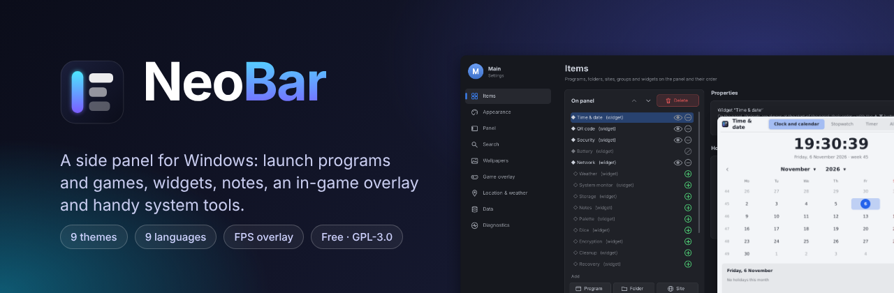
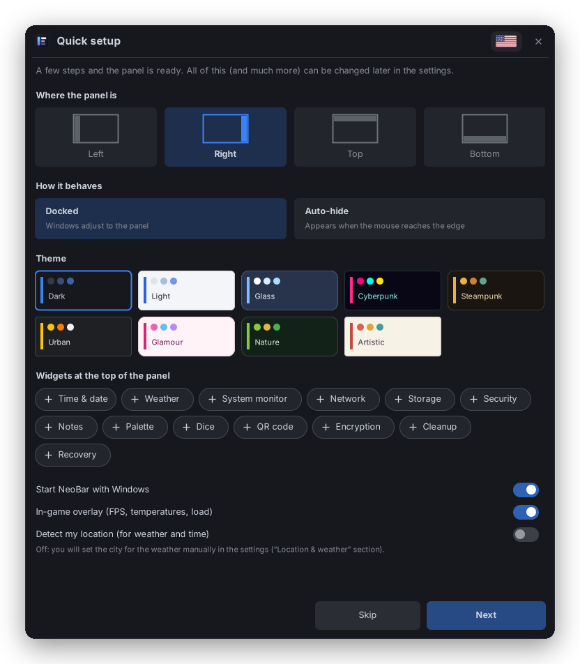
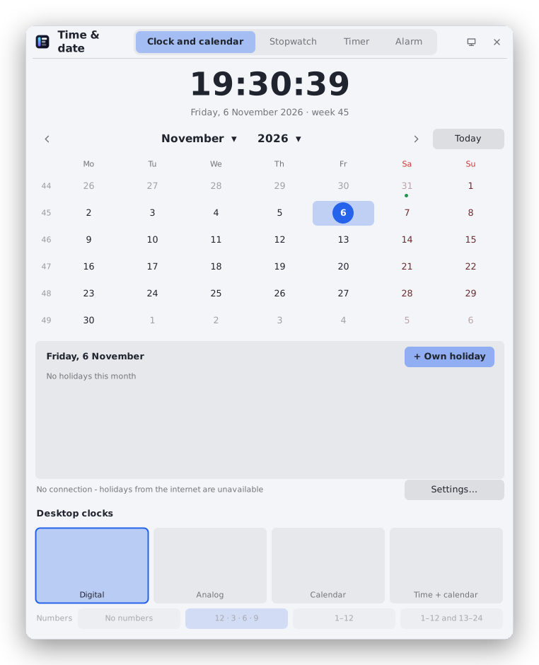
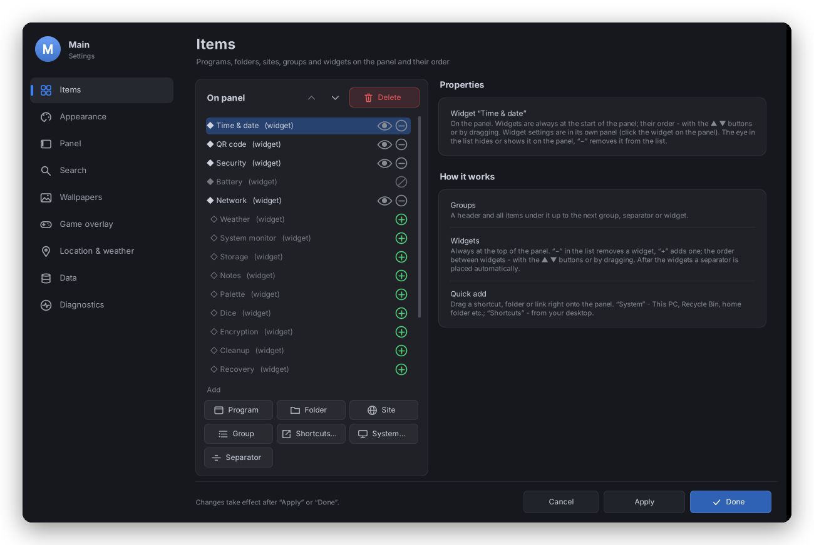
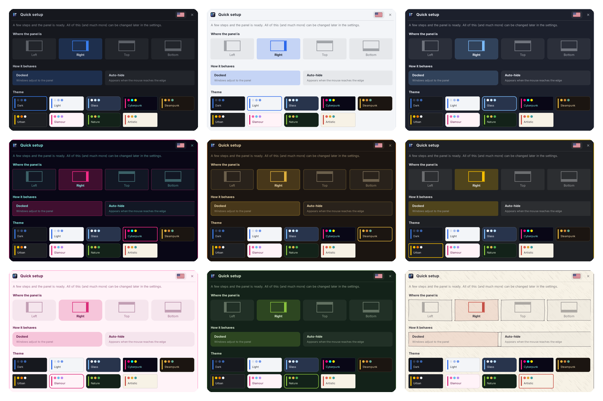
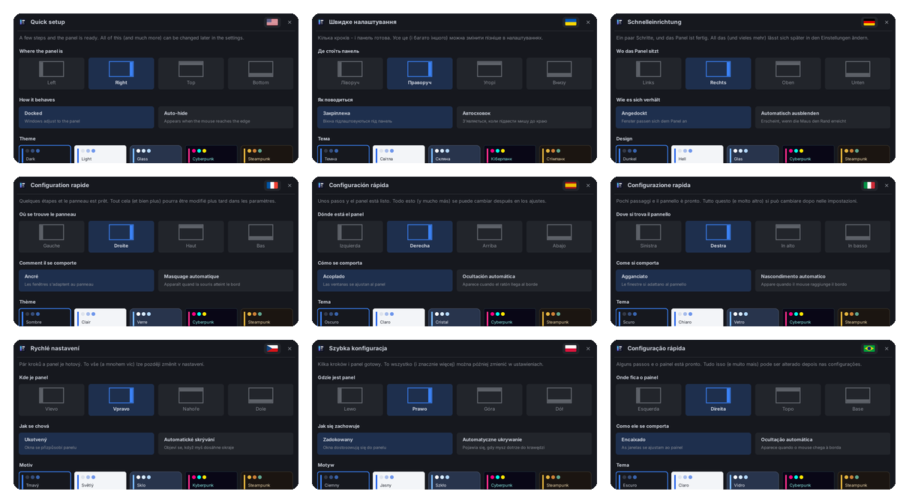

# NeoBar

A side panel for Windows 10/11: launch programs and games, widgets, desktop notes, an in-game overlay, and tools for drives, network and security.

[Українська](README.uk.md)

## Features

- **Panel** - programs, folders, sites and groups; docked or auto-hide, any screen edge; search with an NTFS index, a calculator and unit conversion; profiles with a PIN.
- **Widgets** - clock, calendar, alarms and timers, weather, system monitor, network and ping, drives, battery, notes, color picker, dice, QR codes; most can also live on the desktop.
- **Games** - overlay with FPS, frame times and sensors, frame limiter, borderless fullscreen; anti-cheat games are left alone unless you allow it.
- **Wallpapers** - images, slideshows with transitions, live (video / GIF) wallpapers.
- **Tools** - junk cleanup, process and service manager, process load analysis with a log, file recovery, disk health (SMART) and formatting, firewall and Wi-Fi, security check, file encryption.
- **Themes** - 9 themes, a custom one, festive themes; interface in 9 languages (Ukrainian, English, German, French, Spanish, Italian, Czech, Polish, Brazilian Portuguese) and your own translations.

## Screenshots

  
  

### Themes

Nine built-in themes (dark, light, glass, cyberpunk, steampunk, urban, glamour, nature, artistic), a custom one and festive themes.

### Languages

Ukrainian, English, German, French, Spanish, Italian, Czech, Polish and Brazilian Portuguese - or add your own.

## Download and install

Get the latest version from the [Releases](../../releases) page:

- `NeoBar-x.y.z-setup.exe` - installer (no administrator rights needed, installs for the current user);
- `NeoBar-x.y.z-portable.zip` - portable version: extract to any writable folder and run `NeoBar.exe`.

`SHA256SUMS.txt` on the release page lets you check the downloaded files.
NeoBar can also update itself: it offers a newer release at startup and, only after your consent, downloads it from GitHub, verifies the checksum, installs it and restarts.
Requirements: Windows 10 or 11 (64- or 32-bit), .NET Framework 4.x (built into Windows).

A new program may trigger a SmartScreen warning ("Windows protected your PC") until it gains reputation:
check that the file is signed by the author (Properties → Digital Signatures), then click **More info → Run anyway**.

Some features (FPS in games, CPU temperature, disk maintenance) need administrator rights;
NeoBar asks for them only when needed, or can always start elevated (Settings → Panel).

## Build from source

See [CONTRIBUTING.md](CONTRIBUTING.md). In short: run `build.bat` on Windows - the program appears in `dist\NeoBar`.

## Contributing and translations

Bug reports, ideas, code and translations are welcome - see [CONTRIBUTING.md](CONTRIBUTING.md).

## License

NeoBar is free software under the [GNU General Public License v3.0](LICENSE): you can use, study, change and share it;
changed versions must stay under the same license with their source code.
Third-party components and their licenses: [THIRD-PARTY-NOTICES.txt](THIRD-PARTY-NOTICES.txt).
