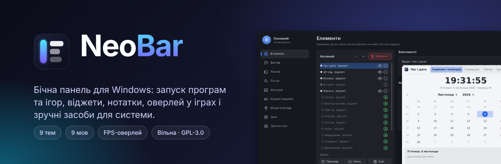
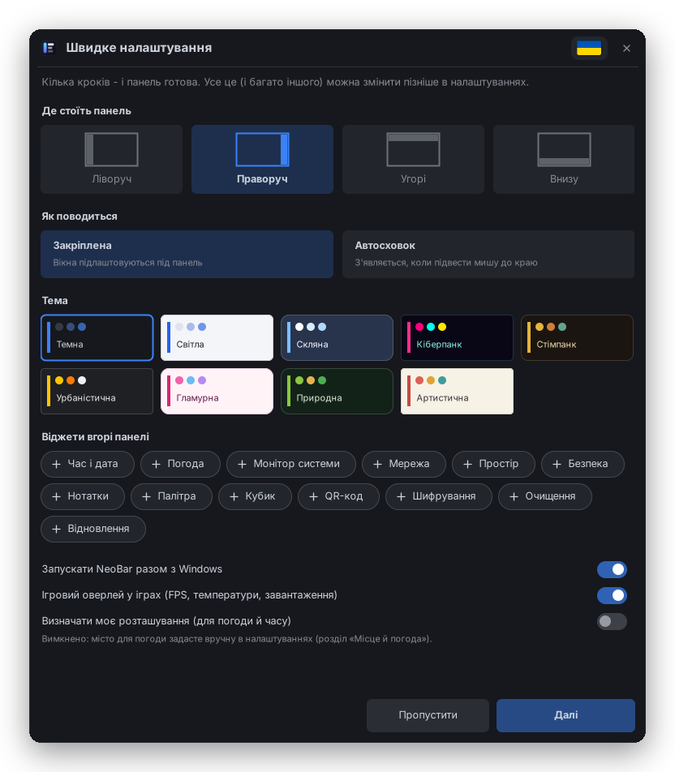
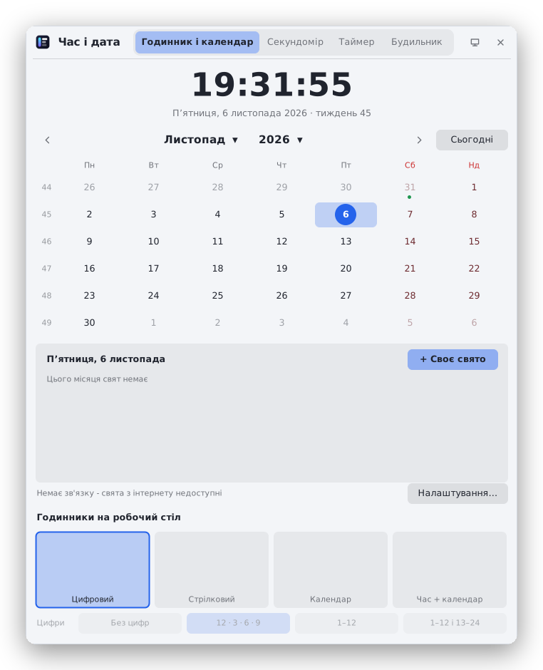
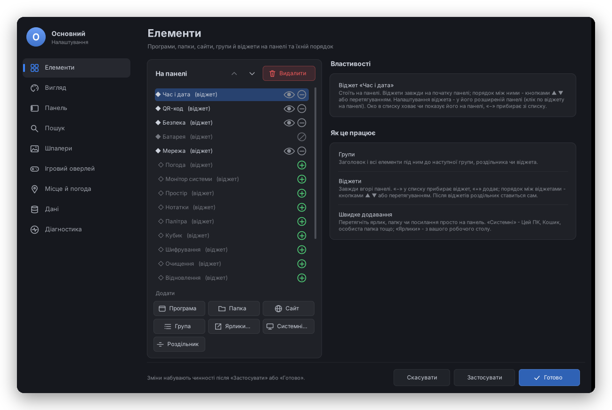
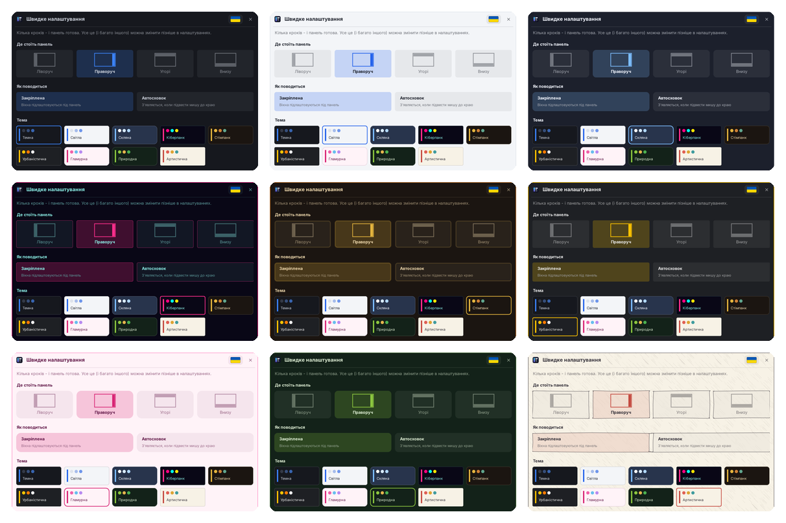
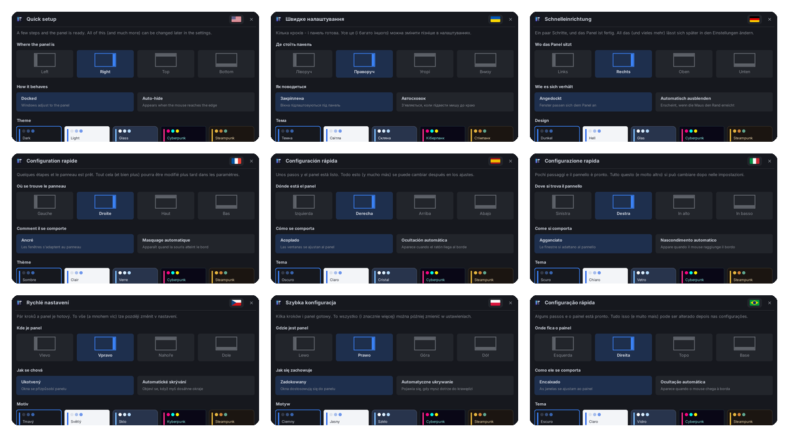

# NeoBar

[English](README.md)

Бічна панель для Windows 10/11: запуск програм та ігор, віджети, нотатки, оверлей у іграх, засоби для дисків, мережі й безпеки.

## Можливості

- **Панель** - програми, теки, сайти й групи; закріплена чи з автосховком, біля будь-якого краю екрана; пошук з індексом NTFS, калькулятором і перетворенням одиниць; профілі з PIN-кодом.
- **Віджети** - годинник, календар, будильники й таймери, погода, монітор системи, мережа й пінг, диски, батарея, нотатки, палітра, кубик, QR-коди; більшість можна поставити й на робочий стіл.
- **Ігри** - оверлей з FPS, часом кадру й датчиками, обмеження кадрів, вікно без рамки; ігри з античітом не чіпаються без вашого дозволу.
- **Шпалери** - зображення, слайд-шоу з переходами, живі шпалери (відео / GIF).
- **Засоби** - очищення сміття, диспетчер процесів і служб, аналіз навантаження процесу з журналом, відновлення файлів, стан дисків (SMART) і форматування, брандмауер і Wi-Fi, перевірка безпеки, шифрування файлів.
- **Теми** - 9 тем, власна та святкові; інтерфейс 9 мовами (українська, англійська, німецька, французька, іспанська, італійська, чеська, польська, бразильська португальська) і ваші переклади.

## Знімки екрана

  
  

### Теми

Дев'ять вбудованих тем (темна, світла, скляна, кіберпанк, стімпанк, міська, гламур, природа, художня), власна й святкові.

### Мови

Українська, англійська, німецька, французька, іспанська, італійська, чеська, польська та бразильська португальська - або додайте свою.

## Структура

| Тека | Що там |
|---|---|
| `src/App` | запуск, профілі, налаштування, журнал, діагностика, видалення слідів (`--uninstall`) |
| `src/Panel` | сама панель, спливні вікна, пошук |
| `src/Ui` | спільні елементи вікон, теми, шрифти |
| `src/Settings` | вікно налаштувань, швидке налаштування, профілі |
| `src/Widgets` | годинник, погода, календар, кубик, QR-код, палітра |
| `src/Notes` | нотатки |
| `src/Seasons` | святкові теми |
| `src/Wallpaper` | шпалери |
| `src/Games` | ігри, FPS, обмеження кадрів, оверлей, шар Vulkan |
| `src/Hardware` | датчики, диски, батарея, форматування, відновлення файлів, процеси й служби |
| `src/Network` | мережа, брандмауер, Wi-Fi |
| `src/Security` | перевірка безпеки, шифрування |
| `src/Maintenance` | очищення |
| `res` | іконка, маніфест, вбудовані шрифти й емодзі |
| `native` | C++-бібліотеки (FPS/оверлей у грі, рушій шпалер) і помічник перетягування |
| `bin` | зібрані бібліотеки з `native` |
| `third-party` | обгортки d3d8to9 і cnc-ddraw |
| `tools/fontgen` | генератор вбудованих шрифтів |
| `installer` | сценарій встановлювача (Inno Setup 6) |

## Збірка

* `build.bat` - збирає програму в `dist\NeoBar` (потрібен лише .NET Framework 4.x, він є у Windows 10/11).
* `native\build-native.bat` - перезбирає бібліотеки в `bin` (потрібен w64devkit); під Linux - `native/build.sh` (mingw-w64).
* `release.bat` - чиста збірка, підпис (якщо є `sign-config.bat`), встановлювач і портативний zip у `dist`.
  Встановлювач потребує [Inno Setup 6](https://jrsoftware.org/isdl.php).

Версія задається у двох місцях: `src/App/AssemblyInfo.cs` і `installer/NeoBar.iss`.

## Підпис

1. Скопіюйте `sign-config.example.bat` у `sign-config.bat` і впишіть відбиток (thumbprint) свого сертифіката.
2. Потрібен `signtool.exe` із Windows SDK (компонент «Signing Tools for Desktop Apps»).
3. `release.bat` підпише exe, бібліотеки, встановлювач і його програму видалення.

`sign-config.bat` у репозиторій не потрапляє (`.gitignore`).

## Мови

Тексти в коді - українською, через `L.T("…")` (вони ж і ключі перекладу). Переклади - `res/lang/*.lang`,
вбудовуються в exe під час збірки. Власний переклад: Налаштування → Вигляд → «Створити шаблон»,
перекласти й покласти в теку `lang` поруч із NeoBar.exe як `код.lang` (наприклад `nl.lang`).

## Портативна версія

Розпакуйте zip у будь-яку теку з правом запису. Профілі й налаштування зберігаються поруч із `NeoBar.exe`.

## Ліцензія

GNU GPL v3.0 ([LICENSE](LICENSE)): програму можна вільно використовувати, вивчати, змінювати й поширювати;
змінені версії мають лишатися під тією ж ліцензією і з відкритим кодом. Сторонні компоненти - [THIRD-PARTY-NOTICES.txt](THIRD-PARTY-NOTICES.txt).

Як допомогти й як перекласти - [CONTRIBUTING.md](CONTRIBUTING.md).
