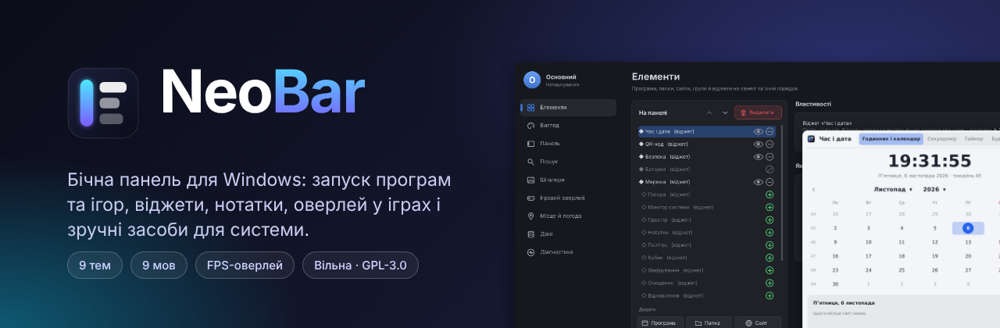

# Вікі NeoBar

NeoBar - бічна панель для Windows 10/11: запускає програми й ігри, показує віджети, зберігає нотатки на робочому столі, малює оверлей у іграх і має засоби для дисків, мережі та безпеки. Вільна програма, GPL-3.0.

**English:** [[Home]]

## З чого почати

- [[Installation-uk]] - встановлення або портативна версія
- [[Panel-and-items-uk]] - край екрана, елементи, групи, пошук, профілі
- [[Widgets-uk]] - годинник, погода, монітор, QR-код та інші
- [[Games-and-overlay-uk]] - FPS-оверлей, обмеження кадрів, безпека з античітами
- [[Wallpapers-and-themes-uk]] - шпалери, теми, мови
- [[Tools-uk]] - очищення, відновлення, диски, брандмауер, перевірка безпеки, шифрування
- [[FAQ-uk]] - SmartScreen, права адміністратора, журнали, скидання
- [[Translating-uk]] - свій переклад
- [[Building-uk]] - збірка з коду

Помилки та ідеї: [Issues](https://github.com/NeoCyberin/NeoBar/issues). Код і переклади: [CONTRIBUTING](https://github.com/NeoCyberin/NeoBar/blob/main/CONTRIBUTING.md).
