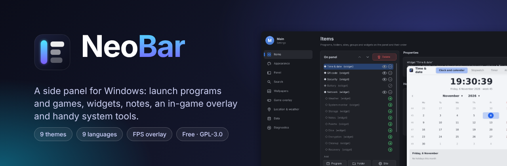

# NeoBar wiki

NeoBar is a side panel for Windows 10/11: it launches programs and games, shows widgets, keeps desktop notes, draws an in-game overlay and has tools for drives, network and security. Free software, GPL-3.0.

**Українською:** [[Home-uk]]

## Where to start

- [[Installation]] - install or run the portable version
- [[Panel and items]] - screen edge, items, groups, search, profiles
- [[Widgets]] - clock, weather, monitor, QR code and the others; widgets on the desktop
- [[Games and overlay]] - FPS overlay, frame limit, anti-cheat safety
- [[Wallpapers and themes]] - slideshows, live wallpapers, themes, languages
- [[Tools]] - cleanup, processes and services, load analysis, recovery, disks, firewall, security check, encryption
- [[FAQ]] - SmartScreen, administrator rights, logs, reset
- [[Translating]] - add your own language
- [[Building]] - build from source

Bugs and ideas: [Issues](https://github.com/NeoCyberin/NeoBar/issues). Code and translations: [CONTRIBUTING](https://github.com/NeoCyberin/NeoBar/blob/main/CONTRIBUTING.md).
