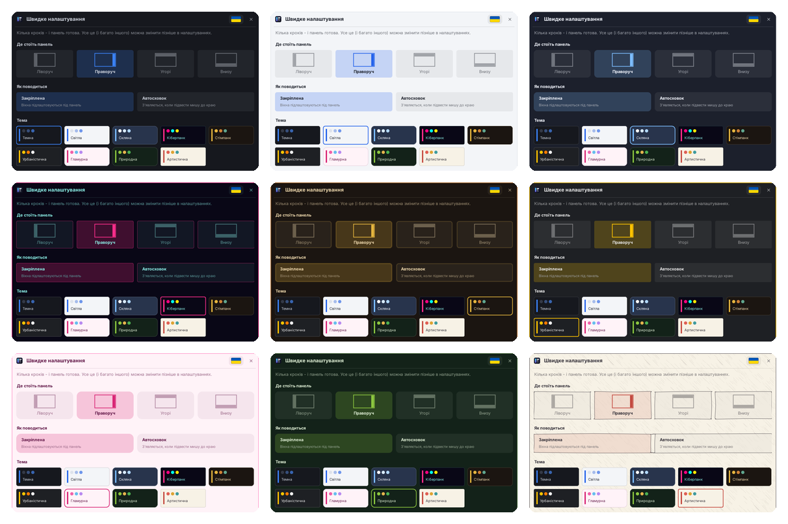

# Шпалери й теми

## Шпалери (Налаштування → Шпалери)

Задаються для кожного профілю. Шпалери NeoBar показуються **поверх** шпалер Windows і не змінюють їх: після виходу з NeoBar знову видно ваші звичні шпалери.

- **Шпалери Windows** - NeoBar нічого не показує й нічого не запускає у фоні.
- **Слайд-шоу** - зображення з галереї (файли копіюються в NeoBar; можна додати цілу теку або перетягнути файли - і тоді, коли NeoBar працює від адміністратора). Зміна щохвилини - раз на добу, випадково чи за назвою, переходи (розчинення, зсув, масштаб, жалюзі, випадковий чи без).
- **Живі шпалери** - відео (MP4, MKV, MOV, AVI, WMV, WebM) або GIF у циклі, за бажанням зі звуком; файли можна перетягнути в галерею або додати кнопкою. Для WebM потрібне розширення Windows «Web Media Extensions» (зазвичай уже є).
- Розміщення: заповнити, вмістити, розтягнути чи по центру. На всіх моніторах чи лише на головному.
- **Пауза**, коли стіл закрито (гра, програма на весь екран чи розгорнуте вікно) і, за бажанням, від батареї.

## Теми (Налаштування → Вигляд)

Дев'ять вбудованих тем: Темна, Світла, Скляна, Кіберпанк, Стімпанк, Міська, Гламур, Природа й Художня. Власна тема дає змінити кольори фону, наведення, тексту й акценту (візьміть поточну за основу), а «Скло» розмиває шпалери робочого столу. Святкові теми (Новий рік, Великдень, ваш день народження та інші) пропонуються за кілька днів до свята. Тема стилізує й власні вікна NeoBar.

## Мови

Українська, англійська, німецька, французька, іспанська, італійська, чеська, польська та бразильська португальська. Оберіть у Налаштування → Вигляд (потрібен перезапуск); тексти, яких немає в мові, показуються англійською. Свою мову додайте за інструкцією [[Translating-uk]].

Назад: [[Home-uk]]
