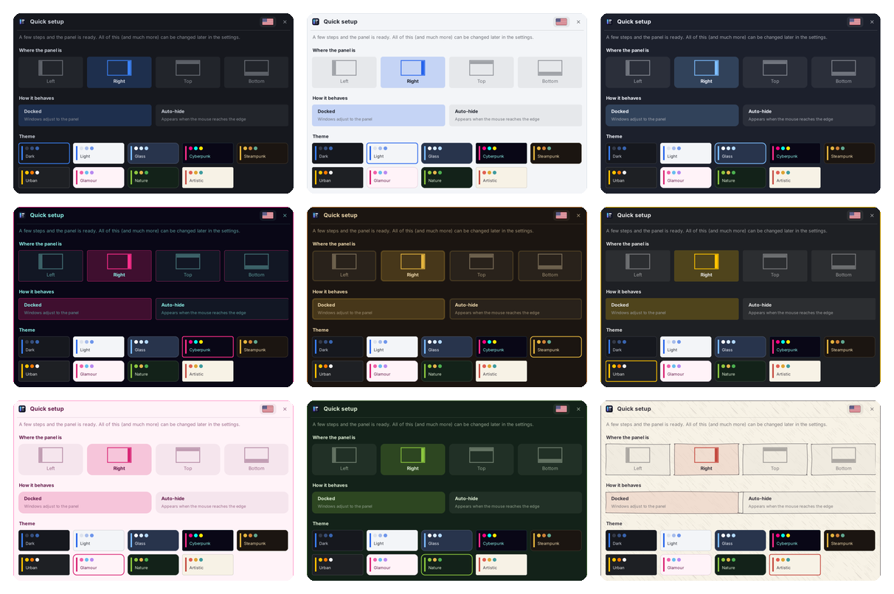

# Wallpapers and themes

## Wallpapers (Settings → Wallpapers)

Set per profile. NeoBar wallpapers are shown **on top of** the Windows wallpaper and do not change it: after you exit NeoBar your usual wallpaper is visible again.

- **Windows wallpaper** - NeoBar shows nothing and runs nothing in the background.
- **Slideshow** - images from a gallery (files are copied into NeoBar; you can add a whole folder or drag files in - this works when NeoBar runs as administrator too). Change every 1 minute to once a day, random or by name, transitions (fade, slide, zoom, blinds, random or none).
- **Live wallpaper** - a video (MP4, MKV, MOV, AVI, WMV, WebM) or GIF, looped, optional sound; drag files into the gallery or add them with the button. WebM needs the Windows *Web Media Extensions* (usually already installed).
- Fit: fill, fit, stretch or centre. Show on all monitors or only the primary one.
- **Pause** when the desktop is covered (a game, fullscreen program or maximised window), while a game is running (even windowed or on another monitor) and, optionally, on battery. When a pause lasts over half a minute the video is closed completely and the video decoder is released - the last frame stays on screen and playback continues from the same spot afterwards.
- **Unstable driver guard**: if the graphics driver resets the engine three times within an hour, NeoBar stops launching it (Windows itself shows the slideshow or image; live wallpaper is replaced by the regular one) and tells you. *Apply* or restarting NeoBar brings it back.

## Themes (Settings → Appearance)

Nine built-in themes: Dark, Light, Glass, Cyberpunk, Steampunk, Urban, Glamour, Nature and Artistic. The **Custom** theme lets you set background, hover, text and accent colours (use the current theme as a base), and Glass blurs the desktop wallpaper. Festive themes (New Year, Easter, your birthday and more) are offered a few days before the holiday. The theme also styles NeoBar's own windows.

## Languages

Ukrainian, English, German, French, Spanish, Italian, Czech, Polish and Brazilian Portuguese. Pick one in Settings → Appearance (a restart is needed); texts missing in a language appear in English. To add your own, see [[Translating]].

Back: [[Home]]
